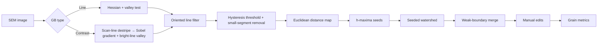

# Grain Tracer

**Detects grain boundaries in SEM images and quantifies grain size distributions (ECD) on the same basis as EBSD.**

Runs as a macOS app (`Grain Tracer.app`) or in a browser (`index.html`). Both use the same code, and image data never leaves your computer.


---

## Background

While crystallizing a-Si thin films with a UV nanosecond laser, I needed to compare grain size across fluence, shot count and scan direction. EBSD required external measurement requests, so not every condition could be measured. Analyzing the SEM images in ImageJ (intensity thresholding) picked up the glow next to boundaries and bright spots inside grains as boundaries, so manual correction was always needed.

Grain Tracer was built to **complement EBSD and compare every condition on the same basis**, with an algorithm designed around the signal characteristics of these SEM images.

## Features

| | |
|---|---|
| **Boundary detection** | `Line` mode (crack/groove-type boundaries) and `Contrast` mode (boundaries seen as tone steps between grains) |
| **Automatic scale** | Detects the Hitachi dotted scale bar (11 ticks) to compute pixel size; reads `PixelSize` from Hitachi `.txt` files |
| **Physical-unit parameters** | All default parameters are defined in nm, so images at different magnifications are analyzed with the same criteria |
| **Manual correction** | Draw boundary (+GB), erase boundary (−GB), split grain (SEED), merge (MRG). Edits are stored as coordinates and persist when you reprocess with new parameters |
| **Metrics** | N, mean and SD, D10/D50/D90, area-weighted ECD, aspect ratio, linear intercept Lx and Ly |
| **Visualization** | Boundary / Grain / Size Map (Turbo, Jet, Viridis, Plasma) / Signal views, number- and area-fraction histograms, comparison plots |
| **Comparison** | Compare checked images as grouped histograms or CDFs. Edits to an image update the comparison immediately |
| **Multiple images** | Open several images at once and switch in the sidebar, run Process All, and copy detection settings with Apply to All Images (converted in nm) |
| **macOS app** | Native window and menus, Open With from Finder, save panels, automatic Hitachi `.txt` pickup |
| **Export** | Grains CSV, Summary CSV (with analysis parameters), Image PNG (current view; Size Map includes a color legend), Plot PNG, Compare CSV |
| **Input formats** | TIF (including Hitachi palette TIF with deflate compression), PNG, JPG |


## Getting started

### macOS app

**Download**: get `GrainTracer-<version>-macOS.zip` from [Releases](../../releases/latest), unzip it and move the app to Applications. Requires macOS 12 or later (Apple Silicon; Intel too when the release says Universal).

- The app is not notarized, so macOS blocks the first launch. On macOS 14 and earlier, right-click the app ▸ **Open**. On macOS 15 and later, try to open it once, then click **Open Anyway** in **System Settings ▸ Privacy & Security**.

**Build from source**: only the Command Line Tools are needed, no Xcode project.

```bash
xcode-select --install   # once, if swiftc is missing
./build.sh               # → build/Grain Tracer.app
open "build/Grain Tracer.app"
```

- Open images with `File ▸ Open Image…` (⌘O), **Open With** in Finder, or by dropping them on the Dock icon. A Hitachi `.txt` with the same name is read automatically.
- Exports are saved through the macOS save panel.

### Browser

Open `index.html` in Chrome, Edge or Safari. It works offline with no external CDN, and can be hosted on GitHub Pages.

### Workflow

1. **Add Images** or drag & drop SEM images. Several can be opened at once; each appears under **Images** in the Analysis Builder.
2. **Scale**: tick spacing is measured automatically. Check that `Bar` matches the scale bar value printed on the image (e.g. `2.00`, `5.00` µm).
3. Choose **Detection ▸ Type** — `Line` (crack/groove boundaries) or `Contrast` (tone steps between grains) — and click **Process** (current image) or **Process All**. Settings tuned on one image can be copied with **Apply to All Images**.
4. Correct with Draw GB / Erase GB / Split / Merge on the **Edit** tab if needed.
5. Enter the condition in each image's **Label** (e.g. `340 mJ/cm² · 800 shots`); it is used as the Compare legend. Check ECD Distribution, Size Map and Compare on the **Results** tab and export CSV or PNG.

> **Open synthetic validation sample** on the empty start screen opens a synthetic image with known ground truth, so you can check the result and its error.

### Layout

| Area | Contents |
|---|---|
| Ribbon | Home (image, scale, detection, view), Edit (correction tools), Results (plots, export) |
| Analysis Builder | Images (open images; Scale, ROI, Detection, Manual Edits of the selected image) → Results |
| Settings | Settings of the selected node |
| Graphics | SEM image with overlay, ECD Distribution, Compare plot |
| Messages / Progress / Table | Log, step progress, grain list |

### Shortcuts

| Key | Action | Key | Action |
|---|---|---|---|
| `V` | Pan | `B` | Draw boundary |
| `R` | ROI (drag corners and edges to resize) | `E` | Erase boundary |
| `S` | Scale line (snaps horizontal/vertical, `Alt` for free angle) | `A` | Add seed (split) |
| `M` | Merge two grains | `F` | Fit |
| `⌘Z` / `Ctrl+Z` | Undo | `Space`+drag | Temporary pan |
| `⌘O` / `Ctrl+O` | Open image | `Esc` | Cancel merge selection |

## Algorithm



1. **Valley filter (Line mode)** — The boundary normal is taken from the Hessian eigenvector. A pixel counts as boundary only when the points ±2σ on **both** sides of the normal are brighter than the center.
   `R = min(I(p + d·n), I(p − d·n)) − I(p)` (dark line)
   This rejects the rims of bright spots and glow edges, which are bright on one side only.
2. **Oriented line filter** — Averages along a fixed length in 12 directions and takes the maximum. Short point noise is suppressed and only continuous boundaries remain.
3. **Hysteresis threshold** — Pixels above `Threshold high` are boundaries; pixels between `low` and `high` are kept only if connected to a strong boundary.
4. **Distance map + h-maxima seeds** — Maxima of height ≥ h in the distance-to-boundary map become grain seeds, so grains are separated even where boundaries are partly broken.
5. **Seeded watershed** — Priority flood on a relief combining boundary signal and distance.
6. **Weak-boundary merge** — Adjacent grains are merged when the mean boundary signal between them is below the threshold, reducing over-segmentation.

### Default parameters (Line mode, in nm → converted from the image pixel size)

| Parameter | Default | Meaning |
|---|---|---|
| Line width (σ) | 4.75 nm | Width of boundary lines to detect |
| Minimum line length | 60 nm | Only lines at least this long count as boundaries |
| Threshold high / low | 0.50 / 0.18 | Hysteresis thresholds |
| Split depth h | 8 nm | Larger values split grains less |
| Weak-boundary merge | 0.15 | Merge threshold for weak boundaries |
| Computation scale | Auto | Downsampling for computation (≈4 nm/px) |

## Metrics

| Metric | Definition |
|---|---|
| **ECD** | Equivalent circle diameter, `ECD = 2√(A/π)` — same grain size definition as EBSD software |
| **Number fraction** | Grains in a bin / total grains |
| **Area fraction** | Total grain area in a bin / total area |
| **Area-weighted ECD** | `Σ(ECDᵢ·Aᵢ) / ΣAᵢ` |
| **Aspect ratio, angle** | Major/minor axis of the equivalent ellipse from second moments, and major-axis direction |
| **Lx, Ly** | Mean linear intercept along x and y test lines (ASTM E112 intercept method). `Lx/Ly` indicates scan-direction anisotropy |

- By default, grains touching the ROI edge and grains below `Minimum ECD` (80 nm) are excluded from statistics. These conditions apply to all open images so comparisons share the same basis.

## Validation

Real SEM images have no ground truth, so the algorithm was validated on **synthetic SEM images** with known boundary positions — an approach used for evaluating SEM measurement algorithms [1] and in grain segmentation studies [2].

- Synthetic image: 105 curved Voronoi grains with point noise, boundary glow, bright spots, scratches and faint boundaries (2048×1536 px, 2.48 nm/px, Hitachi-style scale bar)
- Result: **−2.2 %** against the true mean ECD of 403 nm; automatic scale 2.481 nm/px (set value 2.48)
- Processing time: about 1.2 s per image with automatic segmentation (2048×1536, Chromium)

- [ ] SEM vs. EBSD ECD comparison on the same samples (planned)

## Limitations

- The algorithm was designed around Hitachi SE images of laser-crystallized a-Si films. Other materials or detectors may need parameter tuning.
- Contrast mode can miss boundaries between grains of similar brightness, which then need manual correction.
- The scale bar number (e.g. `2.00um`) is not read by OCR, so check the value yourself.
- Synthetic validation reflects accuracy under the modeled noise conditions; accuracy on real samples needs separate confirmation against EBSD.

## Project structure

```
GrainTracer/
├── index.html            # Browser build (generated by tools/build_web.py)
├── build.sh              # macOS app build (Universal, Command Line Tools)
├── package.sh            # Release zip → dist/
├── RELEASE_NOTES.md      # GitHub Release body
├── .github/workflows/    # Builds the app and publishes a Release on tag push
├── src/
│   ├── gbcore.js         # Core algorithms (also runs in Node.js)
│   ├── app.js            # UI, statistics, plots, export
│   └── ui.html           # Layout and styles
├── vendor/               # UTIF.js, pako (TIFF decoding, MIT)
├── mac/
│   ├── GrainTracer.swift # WKWebView-based macOS shell (open/save panels, menus)
│   ├── Info.plist
│   └── icon_1024.png
├── tools/build_web.py    # src + vendor → index.html
└── docs/                 # README images (generated from the synthetic sample)
```

After editing the code, rebuild `index.html` with `python3 tools/build_web.py` and the app with `./build.sh`.

**Releases**: pushing a tag like `v1.0.0` makes GitHub Actions (`.github/workflows/release.yml`) build the app on macOS and attach the zip to a Release. To build locally, run `./build.sh && ./package.sh`; the zip goes to `dist/`.

## Tech stack

Vanilla JavaScript (Canvas 2D, Typed Arrays) · Swift + WKWebView (macOS shell) · [UTIF.js](https://github.com/photopea/UTIF.js), [pako](https://github.com/nodeca/pako) (TIFF decoding) · No server

## References

1. P. Cizmar, A. E. Vladár, B. Ming, M. T. Postek, "Simulated SEM images for resolution measurement," *Scanning* **30**, 381–391 (2008).
2. Warren et al., "Grain and grain boundary segmentation using machine learning with real and generated datasets," arXiv:2307.05911 (2023).
3. P. F. Felzenszwalb, D. P. Huttenlocher, "Distance transforms of sampled functions," *Theory of Computing* **8**, 415–428 (2012).
4. L. Vincent, "Morphological grayscale reconstruction in image analysis," *IEEE Trans. Image Process.* **2**, 176–201 (1993).
5. ASTM E112, *Standard Test Methods for Determining Average Grain Size*.

## License

MIT
