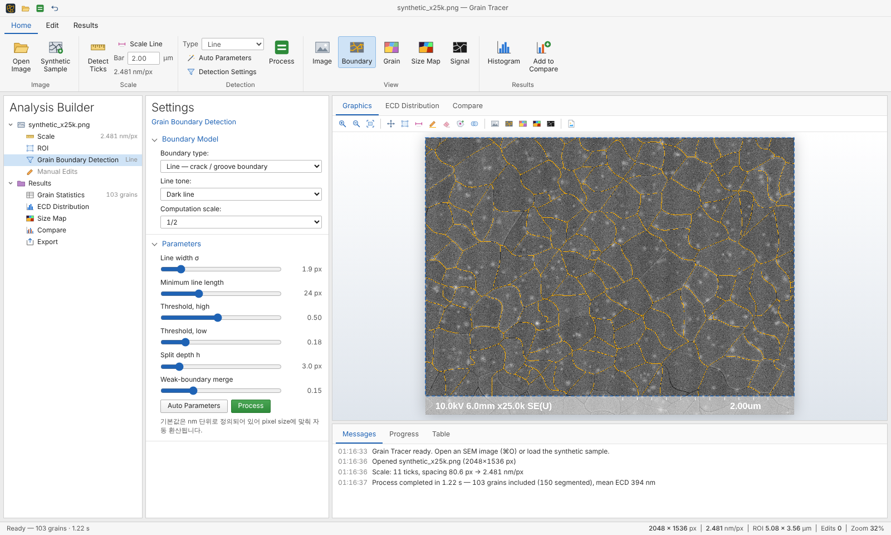
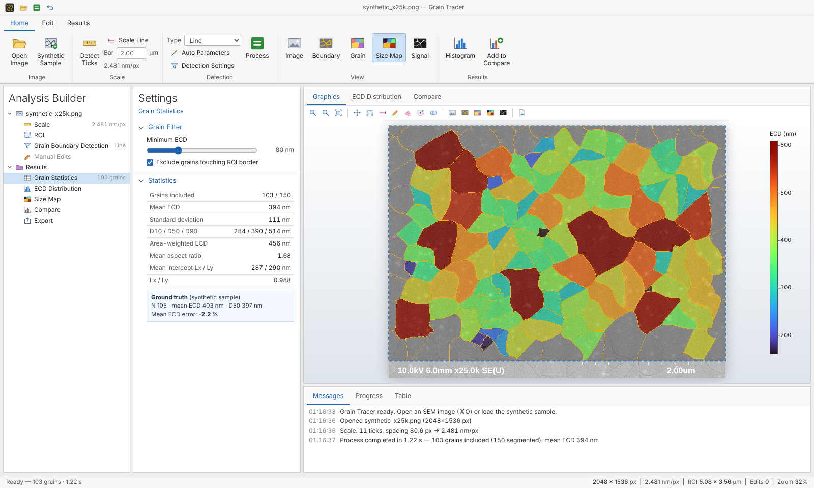
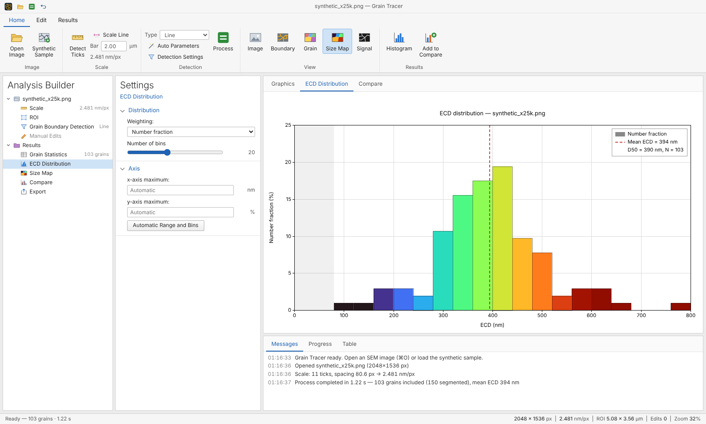
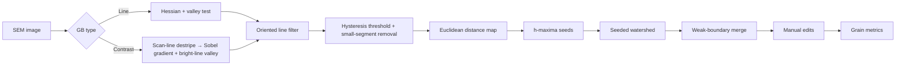

# Grain Tracer

**SEM 이미지에서 grain boundary를 검출하고, EBSD와 같은 기준(ECD)으로 grain size 분포를 정량화하는 분석 툴**

macOS 앱(`Grain Tracer.app`)과 브라우저(`index.html`) 두 형태로 실행됩니다. 두 형태는 같은 코드를 사용하며, 이미지 데이터는 컴퓨터 밖으로 전송되지 않습니다.



---

## 개발 배경

UV 나노초 레이저로 a-Si 박막을 결정화하면서 fluence·shot 수·스캔 방향에 따른 grain size를 비교해야 했습니다. EBSD는 외부 분석 의뢰가 필요해 모든 조건을 측정할 수 없었고, SEM 이미지를 ImageJ(밝기 threshold 기반)로 분석하면 경계 옆 glow와 grain 내부 bright spot까지 경계로 인식되어 결국 수작업 보정이 필요했습니다.

Grain Tracer는 **EBSD를 보완해 모든 조건을 같은 기준으로 비교**하기 위해, 시료 SEM 이미지의 신호 특성을 알고리즘에 반영해 직접 개발한 툴입니다.

## 주요 기능

| 구분 | 내용 |
|---|---|
| **경계 검출** | `Line` 모드(crack·groove 형태 경계) / `Contrast` 모드(grain 간 명암 차로 보이는 경계) |
| **Scale 자동 인식** | Hitachi SEM 하단 dotted scale 눈금(11 ticks)을 검출해 pixel size 자동 계산, Hitachi `.txt`의 `PixelSize` 읽기 지원 |
| **물리 단위 파라미터** | 모든 기본 파라미터를 nm 단위로 정의 → 배율·해상도가 달라도 같은 기준으로 분석 |
| **수동 보정** | 경계 그리기(+GB) / 지우기(−GB) / grain 분할(SEED) / 병합(MRG). 보정 기록이 좌표로 저장되어 파라미터를 바꿔 재분석해도 유지 |
| **정량 지표** | N, mean·SD, D10/D50/D90, area-weighted ECD, aspect ratio, linear intercept Lx·Ly |
| **시각화** | Boundary / Grain / Size Map(Turbo·Jet·Viridis·Plasma) / Signal view, number·area fraction histogram, 조건별 비교 plot |
| **조건 비교** | 열린 이미지 중 체크한 결과를 grouped histogram / CDF로 비교. 이미지를 다시 보정하면 비교에 바로 반영 |
| **여러 이미지 동시 작업** | 여러 장을 한 번에 열고 사이드바에서 전환, Process All로 일괄 처리, Apply to All Images로 detection 설정을 nm 기준으로 환산해 복사 |
| **macOS 앱** | 네이티브 창·메뉴, Finder에서 열기, 저장 패널, Hitachi `.txt` 자동 인식 |
| **Export** | Grains CSV, Summary CSV(분석 파라미터 포함), Image PNG(현재 view, Size Map은 color legend 포함), Plot PNG, Compare CSV |
| **입력 형식** | TIF(Hitachi palette TIF, deflate 압축 포함), PNG, JPG |





## 실행

### macOS 앱

Xcode 없이 Command Line Tools만으로 빌드합니다.

```bash
xcode-select --install   # 처음 한 번 (swiftc가 없을 때)
./build.sh               # → build/Grain Tracer.app
open "build/Grain Tracer.app"
```

- 서명되지 않은 앱이므로 첫 실행은 Finder에서 **우클릭 ▸ 열기**로 실행합니다.
- `File ▸ Open Image…`(⌘O), Finder의 **다음으로 열기**, Dock 아이콘에 끌어 놓기로 이미지를 열 수 있습니다. 같은 이름의 Hitachi `.txt`가 있으면 PixelSize를 자동으로 함께 읽습니다.
- Export는 macOS 저장 패널로 저장됩니다.
- 요구 사항: macOS 12 이상

### 브라우저

`index.html`을 Chrome·Edge·Safari로 엽니다. GitHub Pages로 배포하면 링크로 바로 사용할 수 있습니다. 외부 CDN 없이 오프라인에서도 동작합니다.

### 사용 순서

1. **Add Images** 또는 drag & drop으로 SEM 이미지를 불러옵니다. 여러 장을 한 번에 열 수 있고, 각 이미지는 Analysis Builder의 **Images** 아래에 추가됩니다.
2. **Scale** — 하단 눈금 간격은 자동으로 측정됩니다. `Bar` 값이 이미지에 인쇄된 scale bar 값(예: `2.00`, `5.00` µm)과 같은지 확인합니다.
3. **Detection ▸ Type**에서 `Line`(crack·groove 경계) 또는 `Contrast`(grain 간 명암 차)를 선택하고 **Process**(현재 이미지) 또는 **Process All**(모든 이미지)을 누릅니다. 한 이미지에서 맞춘 설정은 **Apply to All Images**로 나머지에 복사할 수 있습니다.
4. 필요하면 **Edit** 탭의 Draw GB / Erase GB / Split / Merge로 보정합니다.
5. 각 이미지의 **Label**에 조건(예: `340 mJ/cm² · 800 shots`)을 적어두면 Compare 범례에 그대로 쓰입니다. **Results** 탭에서 ECD Distribution, Size Map, Compare를 확인하고 CSV·PNG로 내보냅니다.

> 이미지가 없는 첫 화면의 **검증용 합성 샘플 열기**로 정답(ground truth)을 아는 합성 이미지를 열어 결과와 오차를 확인할 수 있습니다.

### 화면 구성

| 영역 | 내용 |
|---|---|
| Ribbon | Home(이미지·scale·detection·view), Edit(보정 도구), Results(plot·export) |
| Analysis Builder | Images(열린 이미지 목록, 선택한 이미지의 Scale · ROI · Detection · Manual Edits) → Results 순서의 분석 트리 |
| Settings | 선택한 노드의 설정 |
| Graphics | SEM 이미지와 overlay, ECD Distribution, Compare plot |
| Messages / Progress / Table | 처리 기록, 단계별 진행, grain 목록 |

### 단축키

| 키 | 기능 | 키 | 기능 |
|---|---|---|---|
| `V` | Pan | `B` | 경계 그리기 |
| `R` | ROI (모서리·변 드래그로 크기 조절) | `E` | 경계 지우기 |
| `S` | Scale line (수평/수직 자동, `Alt` 자유 각도) | `A` | Seed 추가 (split) |
| `M` | 두 grain 병합 | `F` | Fit |
| `⌘Z` / `Ctrl+Z` | Undo | `Space`+드래그 | 임시 Pan |
| `⌘O` / `Ctrl+O` | Open image | `Esc` | Merge 선택 취소 |

## 알고리즘



1. **Valley 필터 (Line 모드)** — Hessian 고유벡터로 경계 법선 방향을 구한 뒤, 법선 양쪽 ±2σ 지점이 **모두** 중심보다 밝을 때만 경계 신호로 인정합니다.
   `R = min(I(p + d·n), I(p − d·n)) − I(p)` (dark line 기준)
   한쪽만 밝은 bright spot 테두리나 glow 경계(edge)를 걸러내는 것이 핵심입니다.
2. **Oriented line filter** — 12개 방향으로 일정 길이 구간 평균을 구해 최대값을 취합니다. 짧은 점 노이즈는 약해지고 이어진 경계만 남습니다.
3. **Hysteresis threshold** — `Threshold high` 이상은 확실한 경계, `low`~`high`는 확실한 경계에 연결된 경우만 유지합니다.
4. **Distance map + h-maxima seed** — 경계로부터의 거리 지도에서 높이 h 이상의 극대점을 grain seed로 사용합니다. 경계가 일부 끊겨 있어도 grain 중심 기준으로 분리됩니다.
5. **Seeded watershed** — 경계 신호와 거리 정보를 합친 relief에서 priority flood로 영역을 나눕니다.
6. **Weak-boundary merge** — 인접 grain 사이 경계 신호 평균이 기준보다 약하면 병합해 과분할을 줄입니다.

### 기본 파라미터 (Line 모드, nm 기준 → 이미지 pixel size로 자동 환산)

| 파라미터 | 기본값 | 의미 |
|---|---|---|
| Line width (σ) | 4.75 nm | 검출할 경계선 폭 |
| Minimum line length | 60 nm | 이 길이 이상 이어진 선만 경계로 인정 |
| Threshold high / low | 0.50 / 0.18 | hysteresis threshold |
| Split depth h | 8 nm | 클수록 grain을 덜 분할 |
| Weak-boundary merge | 0.15 | 약한 경계 병합 기준 |
| Computation scale | 자동 | 계산용 downsampling (≈4 nm/px 기준) |

## 측정 지표 정의

| 지표 | 정의 |
|---|---|
| **ECD** | Equivalent Circle Diameter, `ECD = 2√(A/π)` — EBSD 소프트웨어의 grain size 정의와 동일 |
| **Number fraction** | 구간별 grain 개수 / 전체 개수 |
| **Area fraction** | 구간별 grain 면적 합 / 전체 면적 |
| **Area-weighted ECD** | `Σ(ECDᵢ·Aᵢ) / ΣAᵢ` |
| **Aspect ratio, angle** | 2차 모멘트 기반 등가 타원의 장축/단축, 장축 방향 |
| **Lx, Ly** | x·y 방향 test line의 mean linear intercept (ASTM E112 intercept 방식). `Lx/Ly`로 스캔 방향 이방성 평가 |

- 기본 설정에서 ROI 경계에 닿은 grain과 `Minimum ECD`(기본 80 nm) 미만 grain은 통계에서 제외합니다. 이 조건은 비교의 기준이 같도록 열린 모든 이미지에 동일하게 적용됩니다.

## 검증

실제 SEM 이미지에는 정답이 없기 때문에, 경계 위치를 알고 있는 **합성 SEM 이미지**로 알고리즘을 검증했습니다. 이는 SEM 측정 알고리즘 평가 [1]와 grain segmentation 연구 [2]에서 사용되는 방식입니다.

- 합성 이미지: 곡률을 준 Voronoi grain 105개, 점 노이즈, 경계 glow, bright spot, scratch, 희미한 경계 포함 (2048×1536 px, 2.48 nm/px, Hitachi 형식 scale bar)
- 결과: 정답 mean ECD 403 nm 대비 **−2.2 %**, scale 자동 인식 2.481 nm/px (설정값 2.48)
- 처리 시간: 자동 분할 기준 이미지당 약 1.2 s (2048×1536, Chromium)

## 한계

- 알고리즘은 저자의 Hitachi SE 이미지(a-Si 레이저 결정화 박막) 특성에 맞춰 설계되었습니다. 다른 재료·검출기 이미지에서는 파라미터 조정이 필요할 수 있습니다.
- Contrast 모드는 인접 grain의 밝기가 비슷하면 경계를 놓칠 수 있어 수동 보정이 필요합니다.
- Scale bar 숫자(예: `2.00um`)는 문자 인식을 하지 않으므로 값을 직접 확인해야 합니다.
- 합성 이미지 검증은 모델링한 노이즈 조건에서의 정확도이며, 실제 시료 정확도는 EBSD 비교로 별도 확인이 필요합니다.

## 파일 구조

```
GrainTracer/
├── index.html            # 실행 파일 (브라우저용, tools/build_web.py로 생성)
├── build.sh              # macOS 앱 빌드 (Command Line Tools)
├── src/
│   ├── gbcore.js         # 핵심 알고리즘 (Node.js에서도 실행 가능)
│   ├── app.js            # UI 동작, 통계, plot, export
│   └── ui.html           # 화면 구조와 스타일
├── vendor/               # UTIF.js, pako (TIFF 디코딩, MIT)
├── mac/
│   ├── GrainTracer.swift # WKWebView 기반 macOS 셸 (파일 열기·저장 패널, 메뉴)
│   ├── Info.plist
│   └── icon_1024.png
├── tools/build_web.py    # src + vendor → index.html
└── docs/                 # README 이미지 (합성 샘플로 생성)
```

코드를 수정한 뒤에는 `python3 tools/build_web.py`로 `index.html`을 다시 만들고, 앱은 `./build.sh`로 다시 빌드합니다.

## 기술 스택

Vanilla JavaScript (Canvas 2D, Typed Arrays) · Swift + WKWebView (macOS 셸) · [UTIF.js](https://github.com/photopea/UTIF.js), [pako](https://github.com/nodeca/pako) (TIFF 디코딩) · 외부 서버 없음

## References

1. P. Cizmar, A. E. Vladár, B. Ming, M. T. Postek, "Simulated SEM images for resolution measurement," *Scanning* **30**, 381–391 (2008).
2. Warren et al., "Grain and grain boundary segmentation using machine learning with real and generated datasets," arXiv:2307.05911 (2023).
3. P. F. Felzenszwalb, D. P. Huttenlocher, "Distance transforms of sampled functions," *Theory of Computing* **8**, 415–428 (2012).
4. L. Vincent, "Morphological grayscale reconstruction in image analysis," *IEEE Trans. Image Process.* **2**, 176–201 (1993).
5. ASTM E112, *Standard Test Methods for Determining Average Grain Size*.

## License

MIT
